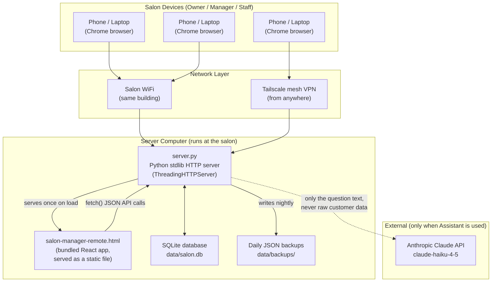
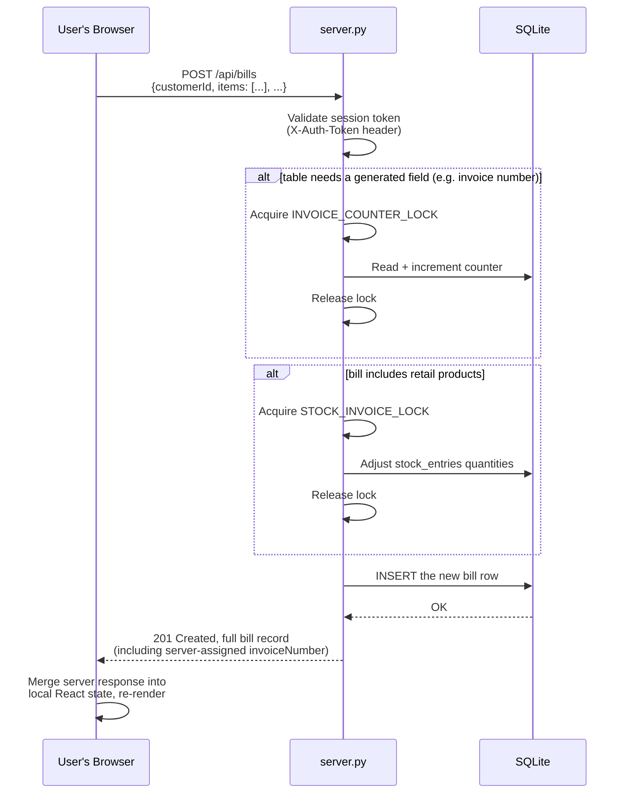
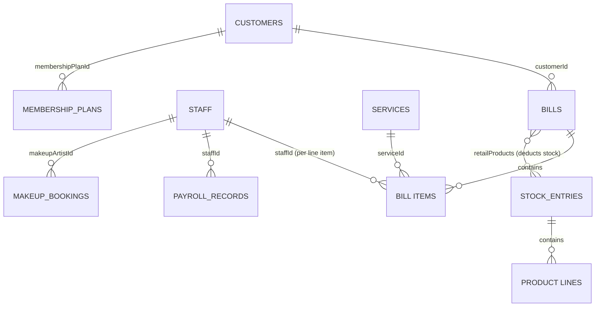

# Salon Manager — Technical Documentation

## 1. Overview

Salon Manager is a self-hosted, multi-user salon management system. One
computer at the salon runs the server; the owner, manager, and staff
connect to it from their own phones or laptops over the salon's WiFi or,
when away from the salon, over a private Tailscale network. There is no
cloud hosting, no monthly SaaS fee, and no third-party server ever holds
the salon's data except Anthropic's API — and only for the specific
question text sent to the optional AI Assistant.

## 2. Technology Stack

| Layer | Technology | Why |
|---|---|---|
| Backend | Python 3, standard library only | No `pip install` needed on the salon's computer — reduces setup friction and long-term dependency risk |
| Database | SQLite (single file, `data/salon.db`) | Zero-configuration, file-based, trivially backed up by copying a file |
| Frontend | React 19.2.5 | Component model suits a data-heavy, multi-tab app well |
| Styling | Tailwind CSS (compiled at build time via the Tailwind CLI) | Utility classes, no runtime CSS-in-JS overhead |
| Bundling | esbuild | Bundles React + all app code into one self-contained `salon-manager-remote.html` — no CDN dependency, works fully offline once loaded |
| Networking (remote access) | Tailscale | Encrypted point-to-point mesh VPN; devices reach the salon's computer directly without opening ports on a router |
| AI Assistant | Anthropic Claude API (`claude-haiku-4-5-20251001`), tool-calling | Cheapest capable model; tool-calling lets it query real salon data rather than guessing |
| Auth | PBKDF2-HMAC-SHA256, 100,000 iterations, per-user random salt | Industry-standard password hashing; no plaintext passwords ever stored |
| Session management | Random opaque tokens, in-memory only, 12-hour expiry | Sessions vanish on server restart by design — nothing persists that could leak if the machine is compromised |

**Notably absent, on purpose:** no Node.js runtime in production, no
Docker, no reverse proxy, no ORM, no message queue. The entire backend is
one Python file (`server.py`) using only what ships with Python itself.

## 3. System Architecture



**Key point:** the browser downloads `salon-manager-remote.html` **once**
per session. After that, every action (adding a customer, saving a bill,
marking attendance) is a small JSON `fetch()` call to the same server —
the page itself never reloads. This is why the app feels instant even
over a phone's WiFi connection.

## 4. Request Flow (a single action, end to end)



Every entity (customers, staff, bills, appointments, and so on) follows
this same generic create/read/update/delete pattern through one shared set
of handlers — see Section 6.

## 5. Data Model

All data lives in one SQLite file. Every table follows the same shape:

```sql
CREATE TABLE <table_name> (
    id TEXT PRIMARY KEY,
    data TEXT NOT NULL,       -- JSON blob holding the actual record
    updated_at TEXT NOT NULL
);
```

This "flexible JSON blob" design means adding a new field to any entity
(like adding `dailyTarget` to staff, or `retailProducts` to bills) never
requires a schema migration — it's just a new key in the JSON. The
exception is the `users` table, which has real columns (username,
password hash, salt, role) since those need to be queried directly for
login.

### Tables

| Table | Holds |
|---|---|
| `customers` | Name, phone (unique), DOB, gender, membership |
| `staff` | Name, role, phone, monthly/daily targets, incentive % |
| `services` | Name, price, category (Regular/Premium), standard duration |
| `bills` | Line items (each with its own `staffId`), discounts, payment mode, linked retail product sales |
| `membership_plans`, `offer_codes`, `outreach_log` | Membership and win-back/birthday campaign data |
| `enquiries`, `appointments` | Lead tracking and bookings, each with a `source` field |
| `attendance`, `roster` | Per-staff, per-date status records |
| `makeup_bookings` | Bride/Groom/Party packages with full payment and session tracking |
| `stock_entries` | One record per vendor invoice, with a nested array of product line items |
| `pnl_liabilities` | One record per calendar month, holding Rent/EB/Salary/etc. |
| `expenses` | General expense log |
| `payroll_records` | Saved OT + incentive calculations per staff, per day |
| `users` | Login credentials and role (`owner` / `staff` / `admin`) |
| `settings` | Single JSON blob: salon name, inactive-customer threshold, birthday window, invoice counters |

### Entity relationships (how the pieces connect)



A bill is the most connected record in the system: it references a
customer, and each of its line items independently references a staff
member and a service — this is what makes "a couple attended by two
different staff on one bill" work correctly (see Section 7).

## 6. Backend Design Patterns

### Generic entity CRUD
Every table in `ENTITY_TABLES` automatically gets full create/read/
update/delete via one shared set of HTTP handlers — adding a brand-new
feature (like Expenses) to the backend is typically a **one-line change**
(adding the table name to a dictionary), because the generic handler
already knows how to store, retrieve, update, and delete any JSON blob.

### Concurrency safety
Four dedicated locks protect operations where two people acting at
nearly the same instant could otherwise corrupt data:

- `SESSIONS_LOCK` — session token creation/lookup
- `INVOICE_COUNTER_LOCK` — bill invoice numbers (`INV-00001`, etc.)
- `STOCK_INVOICE_LOCK` — vendor invoice numbers *and* stock quantity
  adjustments when a bill sells a tracked product
- `CUSTOMER_PHONE_LOCK` — enforcing one customer per phone number

Each lock is held **through the database commit**, not just around the
in-memory check — an earlier, incorrect version only locked the check,
which let two simultaneous requests both pass validation before either
had written its result. Stress-tested at 30–40 simultaneous requests per
scenario with zero duplicates or lost writes.

### Role-based access
Three roles: `owner` (the person who completed setup), `staff` (anyone
added afterward), and `admin` (a single seeded account, username and
password both `admin` on first run, that also exists automatically on
upgrades to older installs). Only `admin` can see the Profit & Loss
section — enforced both by hiding the navigation item client-side and by
rejecting the underlying `/api/pnl` request server-side for any other
role, so it isn't just a hidden button.

### AI Assistant tool-calling
The Assistant doesn't have blanket access to the database. It can only
call one of nine defined tools (`get_staff_report`,
`get_premium_services_by_staff`, `get_business_summary`,
`get_offer_code_performance`, `get_age_bracket_summary`, `get_enquiries`,
`get_appointments`, `list_staff`, `list_services`), each of which runs a
specific, scoped query and returns structured data — never raw database
access. For multi-part questions, it chains up to 6 tool calls in one
turn before answering.

## 7. Notable Engineering Decisions

- **Per-item staff attribution.** Bills store a `staffId` on each line
  item, not just once per bill — necessary for the common case of two
  customers on one bill being served by two different staff. Every
  revenue report (Staff tab, Service Provider report, Dashboard, the AI
  Assistant) attributes service revenue to whoever actually performed
  that specific service, falling back to the bill's primary staff only
  for bill-level charges that aren't tied to one service (Product Amount,
  Makeup Advance).
- **Margin-only P&L.** Profit & Loss counts product sales by *margin*
  (sale price minus landing price, for units actually sold that month),
  never the full sale value — computed from real retail-sale records on
  bills, not a manual estimate.
- **Stock reconciliation on bill edit/delete, not just create.** Selling
  a tracked product deducts stock automatically; editing that bill's
  quantity up or down adjusts stock by the *difference*, and deleting the
  bill gives the stock back entirely — not just a one-way deduction.

## 8. Deployment Model

1. The server computer runs `server.py` directly with Python (no build
   step at runtime — `salon-manager-remote.html` is pre-bundled).
2. First launch creates `data/salon.db`, auto-imports any legacy JSON data
   if present, and seeds the `admin` account.
3. Other devices reach it via the server computer's local IP address (same
   WiFi) or its Tailscale address (from anywhere).
4. A backup runs automatically once per day on first login, plus on
   demand from the Backup screen, writing a dated JSON snapshot to
   `data/backups/`.
5. Updating the app means replacing three files (`server.py`,
   `app-remote.jsx`, `salon-manager-remote.html`) — the `data/` folder is
   never touched by an update.

## 9. File Structure

```
SalonManager/
├── server.py                    # entire backend
├── app-remote.jsx               # frontend source (React)
├── salon-manager-remote.html    # bundled frontend (what the browser loads)
├── start-server-windows.bat / start-server-mac-linux.sh
├── check-prerequisites-*        # verifies Python is installed
├── install-python-*             # installs Python if missing
├── README.md / INSTRUCTIONS.md / UPGRADE.md / TEST-CASES.md
└── data/                        # created on first run, never in the zip
    ├── salon.db                 # the actual database
    ├── backups/                 # dated JSON snapshots
    └── anthropic-api-key.txt    # optional, for the AI Assistant
```
